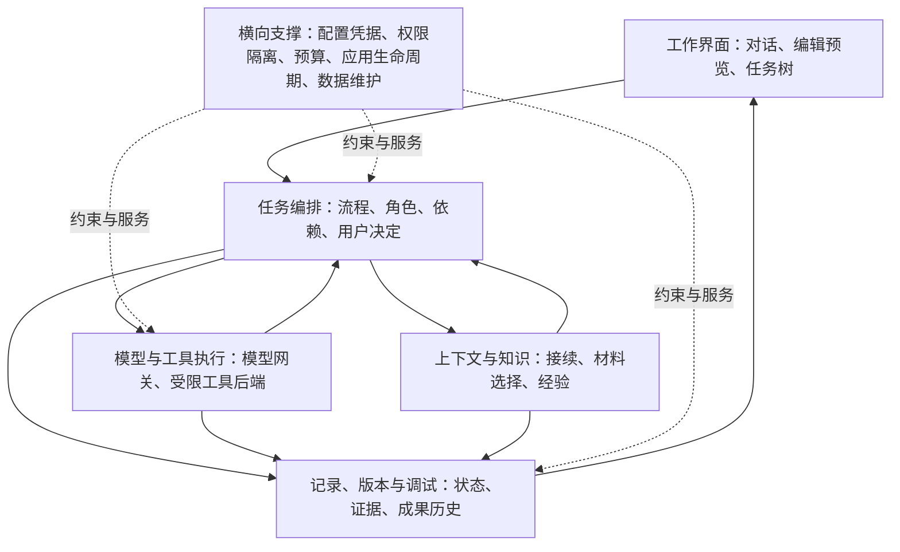

# Agent 独立产品统一设计方案

日期：2026-10-18  
状态：统一设计草案；用户已建立 GitHub／Gitee 仓库，并要求建立首个 M0 OpenSpec change。当前已在 `D:\Cona` 建立提案，未复制代码或实施原型、正式应用开发。  
配套：[产品大框架讨论纪要](../collab/sessions/2026-10-18-product-framework-discussion.md)。

## 一、设计依据与决策状态

本文将已经确定的产品选择组织成可继续立项的整体方案。文中分为三种状态：

- **已确认**：来自用户明确选择或认可，后续不应无故重新询问。
- **设计默认**：为形成完整方案补充的建议，当前按此组织设计，允许以后调整；不冒充用户已经逐项认可。
- **验证门槛**：需要技术验证或真实使用证据才能承诺的能力。

产品名称已于 2026-10-18 确认为 **Cona**，取自 **Continue + Agent**，文件夹名使用 `cona`。当前设计与提案工作区为 `D:\Cona`。用户已建立 [GitHub 仓库](https://github.com/pomelotea-yuzu/Cona.git)与 [Gitee 仓库](https://gitee.com/yuzu-tea-duck/cona.git)；本次只建立 OpenSpec 配置与提案、更新文档，未初始化本地 Git、提交或推送。

### 1.1 已确认的硬边界

| 主题 | 决定 |
|---|---|
| 产品 | 独立产品、独立文件夹开发；必要代码从 ReBaseAgent 复制后独立维护 |
| 名称 | Cona（Continue + Agent），文件夹名 `cona` |
| 工作重点 | 安全可控、易用美观；作为设计、实现取舍和首版验收的共同依据 |
| 价值 | 优先减少长任务的人工交接、上下文管理和重复提醒 |
| 工作类型 | 首版开发与文档，视频暂缓；整体框架支持以后扩展创作能力 |
| 工具 | OpenSpec、Remotion 等均为可选工具，不作为核心架构的硬依赖 |
| 入口 | 统一聊天入口，预设流程与自由聊天共存 |
| 协作 | 探索期与人充分讨论；规划可独立审阅；已确定范围内持续执行 |
| 模型 | 多 API，按阶段选择模型；允许在预设模型与额度内自主求助和升级 |
| 模型资料发送 | 按项目限定可发送范围，默认排除密钥和凭据，可主动排除额外敏感目录；首次说明接收方与范围，授权范围内不反复询问 |
| 任务 | 项目下任务树；动态细化，正式拆分先获许可；批准执行安排后可自主并行 |
| 资料 | 讨论、草稿、经验等主要由应用管理；必要内容复制进仓库；所选工程工具文件仍按约定在项目内 |
| 记忆 | 分范围、分主题、带来源和适用条件；自动积累，用户可见、可改、可撤销 |
| 界面 | 对话为主、右侧文件与成果；任务树独立页面，以四边可停靠按钮进入 |
| 界面定稿方式 | 先做主工作区、任务树、成果编辑与权限提示的可操作原型，由用户根据实际体验确定风格与交互 |
| 编辑 | 应用内查看和直接修改是首版必备；用户主要需要查看修改文件 |
| 运行 | 单机本地使用；关闭主窗口后后台继续；明确退出时有序停止并保存状态 |
| 平台 | 保留 Windows、macOS、Linux 的跨平台架构，先在 Windows 验证与落地，其他平台后续适配 |
| 安全 | 项目外写入另行授权；命令及子进程也必须受强制执行边界约束 |
| 工作目录与回退 | 首版默认受管理工作副本，成果受控交付到原项目；文件改错可查看差异、恢复版本，交付后的文件也有回退依据 |
| 轻量 | 在兑现安全边界的前提下减少安装、内存与启动负担；优先验证原生轻量隔离路线 |
| 执行自研范围 | 自研执行管理框架与平台适配，复用操作系统隔离机制；先做 Windows 小型原型，验证后确定可交付后端 |
| 验收 | 区分 Agent 已完成与用户已验收，普通任务无需逐项等人工确认 |
| 架构 | 五个核心部分加横向支撑；应用管理流程和状态，模型承担工作并提出建议 |

### 1.2 贯穿产品的工作重点：安全可控、易用美观

用户明确要求从设计之初确立 **“安全可控、易用美观”**。这项要求同时约束架构、执行、交互与视觉设计，贯穿首版建设，不能把界面体验留作功能完成后的附加工作。以下为落实这一要求的设计原则，具体视觉风格与量化体验目标仍需在界面设计和验证中确定。

| 重点 | 设计含义 | 对取舍的约束 |
|---|---|---|
| 安全 | 数据、凭据、文件与外部动作有实际执行边界，失败和恢复有依据 | 不用完整权限降级换取功能跑通，不以可撤销替代防越界 |
| 可控 | 用户清楚工作目标、授权范围、当前状态、改动与消耗，能调整、暂停、停止并核查结果 | 自主推进服从已批准范围；控制入口容易找到，状态真实，批准不意味着无限授权 |
| 易用 | 从表达需求到查看编辑成果有直接路径，合理默认减少配置、交接与重复确认 | 采用渐进展示；授权范围内顺畅执行，必要决定清楚说明对象、影响与选择 |
| 美观 | 信息层级、排版、留白、色彩、图标、布局与交互反馈一致，长时间阅读与编辑舒适 | 从首个产品界面建立视觉规范，避免信息堆积、装饰干扰及状态表达不清 |

轻量是支持上述目标的工程约束：关注安装和资源负担，也关注操作与理解成本。新增功能和技术方案都要说明对这四方面的影响；出现冲突时调整范围、实现或交互，不能通过隐藏限制、取消必要边界或长期搁置界面质量来通过验收。安全提示采用准确、可理解的表达，详细技术证据可展开查看，必要决定所需信息始终可见。

## 二、产品定位与首版交付目标

**以“安全可控、易用美观”为工作重点，构建围绕个人项目持续工作的本地 Agent，首先做好开发与文档，使工作跨阶段、跨模型、跨对话段持续推进，用户保留方向、范围和关键交付的决定权。**

首版以维护者自用为验证起点。用户已确认先在 Windows 验证与落地，整体架构保留后续适配 macOS、Linux 的能力；不要求首版同时支持三个平台。模型通过自备 API 凭据接入。跨设备同步、远程执行与其他操作系统不进入首版交付要求。

首版完成三条端到端流程：

1. **开发工作**：讨论目标 → 形成方案 → 独立审阅与修改 → 执行和检查 → 交付改动；执行中能接续上下文、暂停、求助与重启恢复。
2. **文档工作**：讨论／导入材料 → 编写 → 应用内手改或反馈修改 → 预览与检查 → 输出文件；草稿留在应用资料区，必要成果可交付到项目目录。
3. **项目协作**：批准多个任务与执行安排 → 可并行的开展、有依赖的等待 → 用户集中处理需要决定的事项 → 查看整体进展。

前两条必须从界面完整操作。第三条首版可以采用简单、保守的并发策略，不要求复杂多 Agent 集群或流程画布。

### 2.1 首版纳入与后续扩展

| 首版纳入 | 后续扩展 |
|---|---|
| 项目、任务、阶段、执行段与对话的关联 | 复杂方案分支的自动比较、合并与选择 |
| 文件查看编辑、差异、预览、修改记录 | 完整 IDE 补全、断点调试和插件生态 |
| 开发与文档的基础预设流程 | 更多行业模板和完整可视化流程编辑器 |
| 多模型角色配置、独立审阅、额度内求助 | 根据长期效果自动优化模型路由 |
| 基础任务树、受控拆分、依赖与并行 | 复杂跨项目调度和动态资源优化 |
| 受限执行、版本与可核查恢复 | 任意外部服务副作用的恢复 |
| Markdown、常用 DOCX、PDF 的明确支持范围 | 任意复杂办公文件的完整保真编辑、扫描件 OCR |
| 本地分层知识文档、可见的自动积累 | 云记忆、多设备同步、大规模语义知识库 |

“后续扩展”不作为首版宣传能力。通用聊天保留，不强制创建项目和任务。

## 三、核心对象与关系

| 对象 | 含义与边界 |
|---|---|
| 项目 Project | 长期背景、共享资料、任务集合、可关联的工作目录；不要求一定是 Git 仓库 |
| 任务 Task | 一项可说明目标与交付物的工作，有父任务、依赖、范围、预算和成果 |
| 阶段 Stage | 某个流程内的工作阶段，如讨论、方案、审阅、执行；不等同子任务 |
| 对话 Conversation | 用户看到的讨论与工作交流，可跨多个执行段 |
| 执行段 Segment | 为特定目标准备上下文、模型与工具后的一段工作；切段保留任务和对话归属 |
| 模型运行 Run | 一次执行循环，记录请求、工具与结果；一个任务可有多个 run |
| 工作目录 Workspace | 实际受授权读写的文件区域及环境标识；与项目逻辑对象分别管理 |
| 成果 Artifact | 文档、代码变更集、报告等，关联版本、来源任务及检查证据 |
| 知识文档 Knowledge | 偏好、环境经验、项目决定、通用方法等，有作用范围、来源和有效状态 |
| 用户决定 Decision | 对拆分、执行安排、扩范围、权限、额度、验收等事项的明确决定 |

树只表达任务归属，依赖关系单独表达为无环依赖图。阶段与方案尝试也各自独立，不能把三种关系塞进同一个 parent 字段。

首版限制正式子任务必须获准；树的深度不靠模型无限递归增加。细碎操作用任务内部检查清单组织。依赖自环、循环依赖和父子关系循环由程序拒绝。

### 3.1 状态分开管理

任务运行状态建议为：草稿、已规划、等待许可、可执行、运行中、等待依赖、等待用户、已暂停、需排查、Agent 已完成、已取消。

验收状态独立为：不要求验收、待验收、已验收、需修改。成果改动后，关联的旧验收只对原版本有效。阶段有自己的就绪／运行／完成状态，不把模型的一次回答结束等同整个任务完成。

## 四、系统结构与职责边界



### 4.1 五个核心部分

| 模块 | 拥有的职责 | 对外提供 |
|---|---|---|
| 工作界面 | 导航、对话、任务树、文件编辑预览、状态和决定入口 | 用户意图、编辑请求、明确决定 |
| 任务编排 | 任务状态、阶段推进、角色安排、依赖调度、暂停接续、完成判定 | 下一项工作、上下文需求、受授权执行请求 |
| 上下文与知识 | 筛选材料、组织执行段、知识读写建议、来源和冲突处理 | 有版本与来源的上下文包 |
| 模型与工具执行 | 模型协议适配、工具调用、进程和日志、实际执行结果 | 响应、工具证据、用量和终止原因 |
| 记录、版本与调试 | 持久状态、事件、版本、证据、费用、回顾与差异 | 可查询事实、恢复点和诊断视图 |

应用编排掌握工作状态。模型输出的“完成”“审批通过”“已经保存”都要对应实际结果和权限记录，不能直接修改可信状态。

### 4.2 横向支撑

- 配置与凭据：全局默认、项目覆盖、任务覆盖；密钥由宿主凭据服务管理。
- 权限与隔离：工作目录、额外读写、网络、进程、工具能力及授权失效。
- 预算：并发预留、用量结算、价格版本、升级与暂停。
- 应用生命周期：托盘、后台调度、单实例、停止、退出和异常恢复。
- 数据维护：原子写入、备份、迁移、完整性检查、导出与清理。

这些横向服务以明确接口参与，不发展成承担所有业务的巨大单例。

## 五、技术与进程方案

以下为设计默认，最终版本在新项目建立时锁定，本文不安装依赖。

| 部分 | 建议 |
|---|---|
| 桌面与界面 | Electron、React、TypeScript，沿用已有经验与可复用组件 |
| 构建与包管理 | pnpm 工作区，独立项目内管理，不依赖旧仓库路径 |
| 文本与代码编辑 | Monaco；Markdown 编辑与渲染分开，补充搜索、差异、保存与冲突处理 |
| 状态与索引 | SQLite，使用迁移版本；首版全文检索与标签过滤，不强制向量数据库 |
| 文档和附件 | 可读文件、内容寻址附件；保留导出能力 |
| 观测 | 应用事件与 JSONL 执行轨迹关联，复用已有 trace 的适合部分 |

### 5.1 进程与信任边界

1. **界面进程**：展示与编辑，不持有模型密钥，不拥有任意系统调用入口；通过窄 IPC 发起操作。
2. **可信宿主／应用服务**：掌握任务状态、授权、凭据、预算和存储。文档渲染、索引等重任务移到专用进程，避免阻塞主界面。
3. **模型网关**：由可信侧持有凭据并向模型服务发送请求；工具进程拿不到 API 密钥和完整宿主环境变量。
4. **受限执行后端**：运行工具、项目脚本及其子进程，受操作系统边界约束。独立 worker 本身不是沙箱。

模型建议的命令必须经过宿主策略与执行后端，不能通过通用 IPC、动态 handler、MCP 或其他扩展绕过同一策略。

### 5.2 新项目代码组织建议

```text
<独立开发目录>/
├─ apps/desktop/                  桌面壳与工作界面
├─ packages/domain/               对象、状态、流程与策略契约
├─ packages/orchestrator/         阶段、依赖、角色、暂停接续
├─ packages/context/              上下文构建、知识选择与更新
├─ packages/runtime/              模型循环、网关、工具调度
├─ packages/execution/            受限后端、文件与命令适配
├─ packages/storage/              SQLite、文件、附件、事件与迁移
├─ packages/documents/            文档编辑、渲染、转换与检查
├─ packages/observability/        轨迹、版本比较、费用与诊断
└─ docs/                          新产品正式设计与必要工程文档
```

这是职责映射，初期可以把相近模块保留为同包内目录，避免为每个概念创建一个包。架构依赖方向优先于包数量。核心 domain 不依赖 OpenSpec、某个模型厂商或文档工具实现。

### 5.3 跨平台核心与平台执行后端

2026-10-18 用户认可“跨平台 Agent 核心加各平台独立沙箱后端”的方向，并明确“先 Windows 没问题”。该决定确定架构方向与平台顺序，不代表某个沙箱已验证可用，也不要求立刻开始开发。

通用核心管理任务、上下文、模型、授权、预算与记录，通过统一执行契约声明读写范围、网络能力、进程控制和资源限制。PowerShell、盘符、Windows 权限及进程接口留在平台适配层，不进入通用业务逻辑。资料格式与任务记录保持可迁移，凭据、路径、文件语义及应用生命周期按平台适配。

| 平台 | 优先验证的执行候选 | 状态 |
|---|---|---|
| Windows | AppContainer、精确 ACL 与 Job Object，配合受控网络和宿主接口 | 首轮验证对象；尚未选定可交付后端 |
| macOS | 基于 Seatbelt 的执行隔离与相应网络、进程管理 | 后续候选；接口适用性、部署和兼容性待验证 |
| Linux | bubblewrap、namespaces／seccomp，配合网络和进程控制 | 后续候选；部署与兼容性待验证 |

各后端必须满足同一安全契约，能力不满足时停用相关执行入口，不通过静默放宽权限制造表面一致。虚拟化／容器可作为后续可选后端，不作为首版默认安装依赖；若原生方案不能兑现安全要求，应重新评估路线。执行器的实现语言尚未锁定，使用 Rust 等语言本身不提供沙箱。

### 5.4 执行系统的自研与复用边界

本轮续谈后，用户认可按以下边界修正文档：**Cona 自研执行框架和平台适配，底层复用成熟的操作系统隔离机制。** 自研的是落实产品需求的执行系统，不把提示词、命令字符串检查或独立 worker 当成隔离底层。

| 层次 | 建设范围 | 首版安排 |
|---|---|---|
| 执行管理框架 | 授权与策略、工具调度、工作副本、文件交付、日志证据、停止与异常恢复 | Cona 自研，统一服务开发与文档工作 |
| 平台执行后端 | 将统一契约映射到系统权限、网络约束、进程与资源控制 | 先实现 Windows 验证原型，再依据结果选定可交付实现；其他平台后续适配 |
| 隔离底层 | 操作系统安全机制、虚拟化与容器运行基础 | 采用成熟能力，首版不自研内核、驱动或虚拟机监控器 |

可信宿主保管任务状态、授权、API 密钥、历史与备份；受限执行器只获得当前工作所需的材料和能力。宿主接口必须核对身份、任务、动作、授权范围及文件版本，不接受执行器提供的任意宿主路径或命令。读写文件、Shell、文档转换和以后接入的扩展工具都要落实同一安全契约。

首个原型只证明受限执行闭环：准备工作范围 → 在受限环境启动程序及其子进程 → 记录结果与文件变化 → 停止并核查进程 → 受控交付或保留恢复状态。它不要求先建设通用沙箱平台、集群调度或完整多 Agent 系统，也不以能运行一个示例命令代替安全验收。具体实现语言、网络后端和系统接口细节由原型提案与实测确定。

## 六、任务编排与多角色工作

### 6.1 流程是配置，不是某个工具的脚本

基础预设建议提供三类：自由对话、开发工作、文档工作。

- 自由对话直接回答与讨论，可逐渐形成项目或任务，不自动扩大工作。
- 开发流程可包含讨论、方案、独立审阅、执行、验证、交付；用户可从已有阶段进入。
- 文档流程可包含明确用途、整理材料、编写、审阅修改、版式检查、交付。

阶段定义至少包含目标、角色、输入与成果、模型配置、可用能力、完成依据、转换条件和用户决定点。工具集成只提供对应材料和操作，不替代阶段定义。

### 6.2 一次执行的顺序

1. 读取已保存的任务目标、流程版本、范围与用户决定。
2. 检查依赖、预算、文件写入占用、权限和必要工具是否就绪。
3. 为当前阶段选择角色与模型，构建带来源的上下文包。
4. 先保存执行段身份和执行意图，再发起模型／工具工作。
5. 收集真实结果、文件变化、证据和用量，增量更新任务事实。
6. 满足阶段出口后推进；需要许可、信息或预算时局部等待。
7. 达到接续边界时保存检查点，准备下一执行段。

阶段转换的内容判断可以借助模型；范围、审批、预算、证据是否存在等程序条件必须实际检查。模型循环停止只代表该 run 结束，编排层决定任务接下来做什么。

### 6.3 独立审阅

审阅者获得用户目标、方案、相关约束、引用依据和所需文件，有独立执行段。编写者的探索过程不默认全量注入审阅上下文。

审阅输出问题清单、依据、严重程度与结论；编写者逐项修改或说明理由，后续审阅能核对是否解决。设计默认限制重复审阅与无进展循环；超出配置次数或反复无进展时汇报，避免消耗预算直到耗尽。

同一强模型的新上下文可以担任审阅者，但不保证消除同模型的共同偏差。完成标准仍依赖实际检查与成果。

### 6.4 并行与共享文件

任务有明确读写目标时按文件或受管理资源协调；范围未知的命令任务，首版保守地占用整个工作目录的写入权。

同一工作目录默认同时只允许一个命令写任务；不冲突的只读审阅、讨论和独立文档可以并行。用户编辑某文件时有编辑占用和版本检查，Agent 不得覆盖未保存缓冲区。

需要多个代码写任务并行时，使用各自受限工作目录或后续方案分支能力，合入前检查差异和共同基线。依赖消费指定成果版本；上游成果变化时，将相关下游输入标为待更新。

## 七、上下文接续与持续任务状态

### 7.1 应用保持连续，模型上下文按段准备

用户看到同一任务内连续的工作记录。每段保留开始理由、模型、上下文来源、工具与权限、工作目录版本、开始和结束时间及终止原因。

上下文包建议按以下内容组织：

1. 当前目标、阶段出口与明确授权范围。
2. 用户持续要求和项目有效约定。
3. 当前文件／成果身份、已验证事实、关键决定。
4. 当前计划、依赖、未解决事项和最近相关对话。
5. 适用知识与技能正文，以及可供后续检索的资料索引。

历史对话保留按需检索；任务中的已有 `tasks` 或规范文件通过指针和版本关联，避免模型维护另一份失真的重复清单。用户反馈保留为 user 输入，不伪装成 tool result。

### 7.2 何时接续

自然阶段边界、模型切换、用户明确要求、上下文预计不足、运行次数或任务预算边界都可以触发准备。

设计默认预留“下一轮输入增长＋工具结果＋输出”的空间，根据模型实际容量和可用估算调整；不把用户的 75% 习惯硬编码成所有模型的固定阈值。无法可靠估算时采取保守分段，并显示估算状态。

只在完整工具轮次或可核查的中止边界封存，不能留下缺少对应结果的半个工具轮次。截断大型输出时保留附件与查询入口，标明已截断。

### 7.3 任务事实与接续摘要

保存经过工具证据支持的进展、用户决定、文件版本和未解决事项；摘要是可重建的材料，不是唯一事实来源。模型声称完成、实际检查通过、用户验收分别保存。

接续保存失败时暂停推进，不能显示“已交接”。下一段先检查实际文件与保存时基线是否一致；存在人工或外部改动时重新读取，不沿用过时结论。

维护摘要、检索、复核和接续所用模型同样计入任务总账。首版以自然节点增量维护，验证收益后再增加自动化频率。

## 八、知识、记忆与技能

### 8.1 文档为主体，数据库负责索引

知识正文保存为可编辑 Markdown 等文件，元信息记录范围、主题、来源、条件、有效状态、修订版本和用户锁定标记。SQLite 管理索引与关系，正文和元信息间有稳定 ID。

范围可组合：个人、设备环境、项目、任务、可复用方法。设备经验带环境标识；与当前电脑、工具版本不匹配时不得直接当成有效规则。

首版检索采用范围过滤、主题／阶段标签、全文搜索和少量模型筛选。先提供摘要目录，相关正文按需加载。暂不引入必须调用远程 embedding 的依赖。

### 8.2 自动积累流程

在有意义的完成点、人工纠正、环境问题解决或阶段结束时，生成增量更新；记录原话／实际操作等来源。合并前检查现有文档，避免反复生成相似条目。

用户明确要求和锁定内容不被推测覆盖。冲突以并列候选或待核查状态保存，不能静默改写事实。正文修改使用版本比较与原子发布。

界面简短展示“新增／更新了哪些经验”，可打开、修改、撤销或改变适用范围；支持只用于当前任务、禁止记忆和分类关闭。

删除或停用的内容不再参与后续检索；历史执行段保留其当时来源身份。历史副本如何彻底清理要有单独的数据删除策略，不能把停用误称为所有历史副本已消失。

### 8.3 技能与工具的区别

技能是任务方法和说明；工具是实际执行能力。读取一个 skill 不会授予文件、网络或发布权限。技能目录可由用户选择，正文版本与适用前提可查询。

项目配置可以显式绑定某阶段的默认技能，系统在执行前加载并检查前提；不依赖模型恰好想起。模型可建议额外方法，但所有工具仍走同一权限和预算路径。

## 九、项目文件与应用资料

### 9.1 数据位置

设计默认应用使用独立、稳定的本机数据根，允许用户选择位置；不得默认把所有资料写入用户代码仓库。路径不能依赖打包后的临时解压目录。

```text
<应用数据根>/
├─ app.db                         项目、任务、阶段、决定、索引与账目
├─ projects/<id>/materials/       讨论、调研、草稿与任务资料
├─ knowledge/                     个人、环境、项目等分主题知识文档
├─ runs/<id>/                     上下文清单、轨迹与日志
├─ artifacts/                     可查看的成果与版本引用
├─ blobs/                         不可变内容附件
├─ workspaces/                    受管理工作副本
└─ backups/                       受保护的备份与恢复数据
```

物理结构是建议，不要求界面暴露所有内部目录。用户可在应用中浏览资料文件夹并打开编辑；索引不能替代真实文件。凭据通过系统加密服务单独存储，不进入上述可导出正文和日志。

### 9.2 文件事实与导出

讨论与中间材料保存在应用资料区；代码、配置及所选工程流程需要的文件在对应工作目录。导出到原项目时展示目标与差异，检查该路径的授权和当前文件版本。

首版采用明确的“复制／更新交付版本”，不建立无感双向同步。导出清单记录来源版本、目标和时间，之后可以判断是否需要更新。

交付前保存目标文件的恢复点，记录本次新增、修改与删除；完成后记录实际交付结果。交付后的文件回退先核对当前版本；出现后续人工或其他工具修改时，保留双方内容并处理冲突，不能直接用旧版本覆盖。交付或恢复中断时保留已完成项与未完成项，不能将部分成功显示为全部成功。

应用和外部编辑器都可能修改文件，因此每次保存与 Agent 写入使用基线哈希／修订号检查。冲突展示差异并保留双方内容，不静默覆盖。

未保存的编辑缓冲区作为应用草稿恢复，不冒充项目文件已经保存；退出或异常后找回草稿时，先与磁盘当前版本比较。外部程序绕过应用锁的改动仍靠版本检测发现，不能声称应用能独占所有外部编辑行为。

## 十、应用内编辑与文档交付

### 10.1 通用文件工作区

支持文件浏览、标签页、搜索、编辑保存、修改标识、差异和撤销。任务切换与进入任务树时保留已打开文件和视图位置。

代码、Markdown、JSON、配置与纯文本直接编辑。Markdown 支持预览及资源引用。大文件、二进制和不支持编码明确显示，不以错误解码后保存覆盖原文件。

人工保存也产生可追踪文件版本；受授权文件选择器发起的用户操作与 Agent 自动操作有不同来源，但共享冲突与备份机制。

### 10.2 DOCX

首版设计目标包括应用内正文及常用格式编辑、预览、保存与 AI 修改。建议富文本编辑器加结构化文档模型，支持标题、段落、列表、表格、图片及基础页面设置，并保存原文件与版本。

优先验证应用生成文档和常见结构的导入。复杂域、修订、嵌入对象等不支持特性须能识别；不得无提示地转换后丢失内容。完整保真不是未经验证的承诺。

编辑视图与真实分页预览分开。需要核验字体、分页、表格跨页、图片、页眉页脚及导出结果；仅将 DOCX 转 HTML 不足以证明最终版式正确。

### 10.3 PDF

首版包括应用内查看、搜索、批注、文本／标记添加和基础页面操作；应用生成的 PDF 可以回到对应源文档编辑并重新导出。保存保留原件，修改后得到新版本。

任意既有 PDF 的原文重排与扫描件修改有独立难度，不作为通用承诺。不支持的修改明确说明，不能以提供下载按钮冒充应用内修改。

### 10.4 渲染与转换后端

文档工具通过能力接口接入，记录版本、字体和转换结果。可比较本地文档引擎与相关库的质量、安装负担和许可证；具体库及是否需要额外运行时要经过验证，不默认要求用户已有某款商业办公软件。

富文本编辑器、OOXML 处理、DOCX 分页和 PDF 输出需要一项早期技术验证。失败时应调整支持范围或实施安排，不能将必需的应用内编辑静默改成仅外部编辑。

导入文档和预览中的脚本、宏与外部资源不自动执行；实际转换后端也走受限进程和明确的文件／网络权限，不能因为文件来自用户选择就放开整个宿主环境。

## 十一、模型、工具与费用

### 11.1 配置与能力

每个 Provider Profile 保存端点、协议类型、密钥引用、模型列表与能力；每个角色选择主模型、允许的求助／升级模型和必要上下文设置。用户只需先配置一条可工作的 API，之后再增加。

首版先验证一条国内可用的兼容协议路径，核心保留协议适配边界。不同服务在流式输出、工具调用、上下文容量、用量和缓存字段上的差异逐项记录，不把“接口兼容”当成全部能力相同。

请求来源包括用户对话、审阅、摘要维护、检索辅助和诊断，全部关联任务及费用。视觉输入若首版任务需要，必须端到端验证附件、消息和 provider 能力；不能只增加上传按钮。

### 11.2 工具契约

工具声明用途、输入输出、读写范围、网络需求、可否中止、超时、重试与副作用类型。安装或读取工具说明不自动获得执行权限。

首版主要工具包括受控文件操作、检索与差异、受限命令、检查结果读取、资料与知识查询、文档处理。MCP 和其他扩展可以后续通过同一契约接入，不必为首版先建设插件市场。

### 11.3 预算实施建议

用户设置项目或任务额度，任务可有子额度；额度分配默认只调整可用份额，父子消耗聚合时不重复计费。

每次请求前以输入估算、输出上限、价格版本等做预算预留，多个任务共享额度时原子预留，完成后按返回用量结算。审阅、重试、摘要与升级也占用额度。

接近配置阈值时提醒；可用额度不足时不启动新的付费调用，保留接续状态并等待追加。流中取消可能已经产生费用，不能视为免费。

用量区分 provider 返回、估算和未知。输入、输出、缓存读写维度按计价规则计算，缓存部分不重复加到输入总量；不同币种单独展示或采用明确汇率版本。

用量或价格无法确定时默认暂停新增自动付费请求，用户可明确选择继续并知悉暂不能准确控制的部分。预算是应用侧控制，不能承诺精确等于服务商最终账单；首版不支持无限重试或隐形升级。

### 11.4 已确认的模型资料发送规则

用户已接受按项目限定可发送资料的建议。首次配置或启用项目模型访问时，清楚说明所用服务商／端点及可发送范围；用户可以排除额外敏感目录和材料。授权范围内的正常请求不反复确认；增加资料范围或更换到未授权接收方时，先核对并取得对应授权。允许本机读取、选择文件或导入项目不自动等于允许发送全部内容，模型升级也不能扩大资料或接收方授权。

密钥与凭据默认排除在模型上下文之外，API 凭据由宿主请求服务按协议用于认证，不放入提示词、附件或工具结果正文。上下文组装与发送前检查共同执行资料边界，覆盖对话、文件、附件、工具输出、日志、记忆、摘要、检索辅助及独立审阅；来自被排除材料的摘录或派生内容不能通过摘要等路径绕过限制。识别到疑似秘密时阻止原文发送并给出处理入口，具体识别能力和误报漏报需验证，不宣称自动识别全部敏感信息。

项目设置展示可发送范围、排除项与接收方，并允许修改或撤销；发送记录保留资料来源、版本与接收方等必要依据，避免在审计中重复保存秘密。撤销后阻止后续发送，已送到外部服务的数据不能以本机回退或删除记录声称撤回。系统沙箱与模型资料发送规则分别验证。

## 十二、权限、沙箱与工作目录

### 12.1 必须兑现的边界

文件工具、Shell、项目脚本、文档转换器和所有子进程都只能在实际授权能力内执行。项目外写入、额外资源和外部动作通过独立授权管理。

工作目录、副本、Git、独立进程和 UI 渲染沙箱都不足以证明命令已经受到操作系统隔离。字符串前缀校验不能覆盖链接、目录联接、路径别名和检查后目标变化。

### 12.2 首版执行策略

**已确认：首版默认在受管理工作副本中完成工作，原项目作为导入与受控交付目标。** 用户说明自己使用的 Agent 通常直接修改原文件，引入 ReBaseAgent 调试能力的重要目的就是文件改错后可以回退，并明确接受受管理副本的建议。工作副本、修改版本与交付回退共同落实这一要求；即便使用副本，命令仍必须在有效沙箱中运行。

直接修改原项目可以作为明确选择的工作方式，在执行隔离、修改备份和冲突检查通过后开放。切换方式不自动授权新目录，也不隐藏真实工作路径。

为工具分配受限工作根、专用临时／缓存路径、必要只读运行时；默认不挂载用户整个主目录、其他盘、应用数据库和备份。网络按任务需求通过策略开放，密钥不注入项目脚本环境。

### 12.3 Windows 后端验证门槛

按安全与轻量并重的方向，首先验证 Windows 原生的 AppContainer、精确 ACL 与 Job Object 组合，配合默认禁止直接联网、按需受控网络访问和窄宿主接口。AppContainer／ACL 承担资源访问边界，Job Object 管理关联进程和资源；它们不是已经验证的成品沙箱。比较 Node／pnpm、Git、文档引擎可用性、读写隔离、网络限制、子进程继承及完整停止行为。仅设置低完整性级别、限制 token 或 Job Object，不可直接宣称完成全部文件与网络限制。

执行器设计默认按需启动，共享必要只读运行时，工作数据按授权隔离；受管理副本避免无必要地反复复制依赖。安装权限、额外依赖、冷启动时间、空闲与运行内存、磁盘增量都要实测，不预先承诺性能数字。项目副本及备份不得通过硬链接与原文件共享可修改内容。原生后端若无法通过边界或兼容性验证，再评估虚拟化／容器候选，不以轻量为理由放弃安全要求。

验证必须实际尝试工作根外写入／删除、链接或 junction 越界、路径替换、嵌套命令、派生子进程、读取凭据和覆盖备份，并验证普通开发及文档处理仍可工作。使用专门测试目录和哨兵文件，不在真实磁盘内容上做破坏实验。

Windows 小型执行原型至少提供下列证据，全部通过后才能将对应能力作为默认执行入口：

| 验证方向 | 出口依据 |
|---|---|
| 正常工作 | Node／pnpm 项目修改、依赖安装和测试、Git 本地操作、至少一条选定文档转换路径可用，必要额外权限明确记录 |
| 文件与凭据 | 授权读写和必要运行时读取正常；未授权文件读写、链接越界、备份修改、测试凭据读取被阻止，环境变量与继承句柄不泄漏宿主能力 |
| 网络与宿主接口 | 获准请求正常；未经允许的直连、代理绕行、本机服务访问及跨任务接口调用被拒绝，不以域名白名单宣称完全防止数据外传 |
| 子进程与停止 | 安装脚本、嵌套命令、后台或脱离父进程的启动尝试受约束；停止后实际核查全部受管理进程状态，不能仅以父进程退出判定完成 |
| 初始化与异常 | 隔离初始化失败时不启动目标程序；取消、宿主崩溃和重启后能识别遗留进程与未知结果，不盲目重放有副作用操作 |
| 交付与轻量 | 导出复核授权、目标和基线，冲突保留双方版本；记录安装依赖、所需权限、启动耗时、空闲／运行内存及磁盘开销 |

任务暂停接续依靠持久记录和文件事实；Job Object 的资源管理、系统隔离和版本恢复分别验收。目标覆盖 Agent 误操作、项目脚本越权及提示注入引导的违规工具操作；共享宿主内核的原生隔离不等同独立虚拟机，不承诺操作系统已失陷时仍能保护数据。

**在后端不能通过边界验证前，不开放具有当前用户完整权限的任意命令作为默认降级。** 可以继续开发对话、编辑器和受控文件能力；真实命令执行与“安全自主开发”的交付应等待解决方案。

### 12.4 用户决定与恢复

授权有目标、动作、范围、有效期和关联任务版本；请求改变或任务扩范围时重新核对。允许某次目标路径不等于永久放开整个磁盘。

高影响批量删除、覆盖等操作展示实际对象和范围，配置决定点。程序生成可检查的操作计划，确认后复核目标版本；批准不是解除沙箱。

备份与不可变成果仅由可信服务维护，执行后端无权清理。版本恢复覆盖记录的文件内容，不承诺恢复外部上传、已发布结果、数据库或运行中进程。

### 12.5 CubeSandbox 调研结论与候选定位

2026-10-18 按用户要求只读核查腾讯云开源 [CubeSandbox](https://github.com/TencentCloud/CubeSandbox) 的 README、部署文档及性能报告。它基于 RustVMM／KVM 微虚拟机，支持模板、写时复制、快照、克隆、暂停恢复、网络控制和凭据代理，并提供 E2B 兼容接口；这些能力有参考价值，不代表已在 Cona 中集成或通过本地安全验证。

- [单节点部署文档](https://github.com/TencentCloud/CubeSandbox/blob/master/docs/guide/bare-metal-deploy.md)要求 Linux、可用 KVM、root 权限、Docker，以及至少 8GB 内存和 50GB 空闲磁盘；还会安装 MySQL、Redis 等组件。这是部署前置容量要求，不是常驻内存实测值。
- [Windows 评估路径](https://github.com/TencentCloud/CubeSandbox/blob/master/docs/guide/dev-environment.md)通过 WSL2、QEMU 与嵌套虚拟化运行 Linux 环境，不是直接嵌入 Windows 原生应用的组件。文档将该路径定位为开发／评估用途。
- README 宣称启动低于 60ms、额外内存开销低于 5MB；[详细性能报告](https://github.com/TencentCloud/CubeSandbox/blob/master/docs/blog/posts/2026-06-01-cubesandbox-perf-benchmark.md)另列创建后空闲实例的整机内存增量摊销约 21～26MB，测试规格为 2 vCPU／2GiB，且模板已准备、测试有预热。不能混用这些口径，不能把 5MB 当作整套系统或真实构建任务的总内存，也不能将其耗时直接套用到 Windows 首次启动。

当前仍优先验证原生轻量执行路线；CubeSandbox 保留为后续 Linux 自托管或远程执行候选，不进入首版默认依赖，也不因此扩大已确认的本地首版范围。可借鉴凭据外置、出口控制、按需唤醒和写时复制的设计；实际复制代码或集成时另行核对版本、依赖、许可证与安全边界。沙箱快照不能撤销已经发生的外部副作用。

## 十三、持久化、版本与异常恢复

### 13.1 权威状态与事件

SQLite 保存任务当前状态、修订号、用户决定、预算预留和可查询事件；同一业务变更在事务中更新状态与事件。模型与工具日志通过关联 ID 指向该事务，界面以可重读状态为准。

文件与数据库不能假设跨介质原子提交。成果先写临时文件并校验、原子发布，再提交数据库引用；使用操作日志和启动恢复处理孤立附件与未提交变更。已发布的文件才可显示为已保存成果。

事件记录请求、授权、开始、结束、失败与未知状态。对任务变更使用幂等操作 ID 和版本检查，避免界面重试产生重复任务或重复授权。

### 13.2 重启恢复

明确退出：停止接收新工作，取消或等待当前操作至配置时限，确认进程树状态，保存记录。无法确认停止的进程显示为待核查，不显示已干净结束。

异常启动后：恢复已提交状态、检查未闭合 run、对照进程和文件版本。先标记为中断，确认边界后再提供继续。操作已经执行但回执丢失时保留“结果未知”，不自动重放有副作用命令。

内存中运行的命令不能凭摘要恢复。文件可重新读取，检查可在适用时重跑；外部副作用必须先核实。系统睡眠时任务不能持续执行，唤醒后检查连接与进程状态。

### 13.3 版本与调试

任务阶段和用户修改自然形成版本点，记录文件／成果哈希、上下文包、技能版本、模型配置、工具证据和验收状态。

首版提供执行回顾、上下文来源、命令日志、文件差异、费用与有限文件恢复。已有工具观察编辑／轮末快照续跑语义只在适合的执行 profile 中复用；不把它直接当成任意命令的时间旅行。

文件改错可回退是已确认的产品要求，覆盖工作副本和受控交付到原项目后的文件。先形成受保护的初始基线，再在执行批次前及阶段完成、用户保存、交付等节点建立可恢复版本；不能只记录专用文件工具的改动而漏掉 Shell 或转换器实际产生的文件变化。恢复前展示文件差异与范围，处理新增、修改、删除及后续编辑冲突，记录恢复结果。恢复以实际保存的文件版本为依据，不宣称撤销外部副作用或恢复全部机器状态。

Git 是用户工程版本的一种可选集成，任务不要求一定有 Git。快照与备份也分别管理，哈希校验不能替代备份。

## 十四、界面、后台与通知

### 14.1 主要页面

- **开始工作**：默认对话入口，可选择项目，也可临时聊天；不先强制选择开发／办公／创作模式。
- **任务工作界面**：对话为主，右侧标签页查看编辑文件与成果；简洁展示阶段、模型、运行状态和预算。
- **任务树页面**：停靠按钮进入，默认当前项目，可切换或查看全部；点击任务与阶段进入对应工作。
- **资料与知识页面**：文件夹组织、来源、有效范围、自动更新记录、编辑与撤销。
- **设置页面**：API、角色模型、流程、额度、工具、权限、数据和后台行为。

项目选择与普通导航可保持轻量，不把整棵任务树挤在对话侧栏。资料和知识也能从任务上下文入口打开，无须每次离开工作。

### 14.2 需要用户处理的事项

界面集中展示待处理项：任务拆分／扩范围、必要信息、权限、预算、关键交付验收。每项说明理由、影响与建议，并能返回对应任务。

一项工作的等待不阻塞其他独立任务。明确拒绝后的任务调整计划或停止，不能通过换模型反复提交同一请求。

### 14.3 后台行为

关闭主窗口留在托盘继续，切任务不停止其他工作；托盘展示运行／等待／异常状态，提供停止全部与明确退出。退出行为与关闭窗口清楚区分。

通知设计默认：阶段完成、任务完成、失败及需要用户参与时通知；普通工具步骤不逐条弹系统通知。应用内有完整记录，同类更新可合并，系统通知可配置。无跨机器推送要求。

### 14.4 易用与美观的设计要求

用户已确认采用“先做可操作原型，再根据实际体验定稿”的方式。原型覆盖主工作区、独立任务树、成果查看编辑及权限提示，串起表达需求、查看进展、处理必要决定、编辑成果和交付的主路径。先由 Agent 给出一致的布局与视觉方案，再由用户实际操作并反馈，确定风格与交互；本轮未制作原型，也未锁定主题、配色或精确尺寸。

- 主工作路径围绕表达目标、了解进展、处理必要决定、查看编辑成果展开；安装、API 配置和常见错误提供明确引导，已支持的主流程可在应用内完成。
- 常用控制与工作状态容易找到；等待、失败、停止中、已停止及结果未知清楚区分，任务切换保留编辑与阅读位置。关键动作有及时反馈，失败说明恢复或下一步操作。
- 项目、模型、权限和预算提供合理默认与逐步展开的高级设置；普通工作不要求用户理解 run、执行段、沙箱后端等实现概念。诊断信息保留查询入口。
- 建立统一的字体层级、间距、颜色、图标、控件与交互状态规范；对话、文件、差异、任务树和决定面板保持一致的信息组织。具体主题和视觉风格尚未锁定。
- 在正常、空白、加载、长内容、失败与权限等待等状态下检查布局；验证窗口缩放、系统显示缩放、键盘操作、焦点可见性和文本对比度，不仅检查单张理想状态截图。

从 M1 起审阅可操作的主要界面和完整路径，每个后续里程碑同时检查新增功能的体验与视觉一致性。技术原型可以简化展示，但原型成功不等于产品界面已达标。

## 十五、旧代码复用核对与迁移方法

本次只读核查 HEAD 为 `2271c04ab5391b37e0a0115004f6f4eb395fc7bf`，根版本 `0.5.0-rc.1`。旧工作区存在其他未提交修改；未运行旧项目测试，不将源码检查写成行为验收。

下表「来源」列指向**参考项目 ReBaseAgent**（本机 `D:\ReBaseAgent`）的路径——本仓库尚未复制任何旧代码，因此这些路径不设为本仓库链接；迁移时按本节末尾的方法确定源提交并只复制最小闭合代码。

| 来源（ReBaseAgent 路径） | 可复用部分 | 需要重做或验证 |
|---|---|---|
| agent-loop（`packages/agent-loop/src/run-loop.ts`） | 消息追加、模型工具循环、终止原因、trace 接口 | 任务／执行段编排、角色状态、真实中止、跨 run 总预算 |
| config（`packages/agent-loop/src/config.ts`） | 运行配置、工具定义与类型校验 | 现有消息正文为字符串／null；附件和视觉输入需新增设计，`cwd` 不提供沙箱 |
| 模型客户端（`packages/agent-loop/src/llm-client.ts`） | 流式聚合、工具调用结构、诊断与部分缓存用量 | 缺失用量的表示、多 provider 能力、输出上限和费用预留；旧实现部分缺失 usage 回退零值不能直接作精确计费 |
| trace-sdk（`packages/trace-sdk/src/index.ts`） | 轨迹 schema、读写、关联、内容哈希等 | 新产品任务与阶段事件、新身份、版本演进及隐私处理 |
| 文件世界（`packages/replay/src/workspace/world.ts`）／工具（`packages/replay/src/workspace/file-tools.ts`） | 不可变内容、路径映射、快照与分支原则 | 只支持逻辑文件读写，不能直接运行真实项目，也没有 OS 隔离 |
| 一致性机制（ReBaseAgent `docs/architecture/replay-state-consistency.md`） | 消息与文件边界对齐、失败拒绝原则 | 真实命令、并发人工编辑、外部副作用和环境变化 |
| trace-test（`packages/trace-test/package.json`） | 卡带与确定性执行结构回归 | 不证明真实模型选择正确、文件渲染正确或沙箱有效 |
| 桌面编辑组件（`apps/desktop/src/renderer/src/components/MonacoEditor.tsx`） | 编辑器封装与适合的文件展示经验 | 面向真实可写项目的编辑、冲突、DOCX/PDF 和新导航 |
| 设置（`apps/desktop/src/main/settings.ts`）／数据路径（`apps/desktop/src/main/data-dir.ts`） | 凭据宿主隔离、路径与便携部署经验 | 多配置、预算、稳定应用资料区；旧明文密钥降级不能作为新默认 |

特别注意：旧配置虽有 `maxCost` 字段，当前 loop 主要检查 `maxTotalTokens`，不能据此认为金额额度已经实现。旧 run ID、固定配额和工具 profile 也不能不核对就迁移到并行真实项目执行。

迁移时先确定源提交和模块依赖，复制最小闭合代码及相关测试，记录来源与修改；保留相应许可证和版权说明。删除旧品牌、旧路径和无关桌面状态耦合，不复制凭据、用户记录、产物或依赖目录。新仓库通过本地依赖构建，不引用旧仓库绝对路径。

## 十六、实施顺序与阶段出口

以下为完整首版的分段交付建议；每段形成独立可审查的工程提案，提案工具可自行选择。

用户已要求将 M0 第一项组织为 OpenSpec change：[Windows 受限执行与文件回退验证](../../openspec/changes/validate-windows-execution-and-file-rollback/proposal.md)。它覆盖执行隔离、受控出口、完整停止、工作副本、版本、交付回退与资源测量；DOCX/PDF 编辑与排版验证另行组织。本次建立提案不等于原型已实现或 M0 已通过。

| 里程碑 | 主要工作 | 出口依据 |
|---|---|---|
| M0：高风险验证 | 先做基于系统隔离机制的 Windows 小型执行原型，验证正常命令、边界、完整停止和资源开销；另验证 DOCX 应用内编辑与分页、PDF 修改与输出路径 | 第 12.3 节各项有实测证据；文档读改存与输出样例通过；不支持项明确 |
| M1：独立基础应用 | 新目录、桌面壳、数据结构、迁移、API 配置、自由对话、文件查看编辑、权限服务；建立基础交互与视觉规范 | 不依赖旧仓库运行；本地保存与重开可用；密钥不泄漏到日志／工具；初始配置与对话／编辑主路径可操作、状态清楚、主要页面视觉一致 |
| M2：可持续单任务 | 任务与阶段、上下文段、单执行者、真实操作、证据、费用及中断恢复 | 同一任务跨两段及重启后继续，文件与任务事实对应，原项目不受副本影响 |
| M3：协作与控制 | 独立审阅、模型求助、并发预算、拆分许可、执行安排、任务树与后台 | 审阅独立、越权拆分被阻止、预算预留不重复、关窗口继续、等待局部化 |
| M4：文档与知识闭环 | DOCX/PDF 工具、资料区、自动记忆、分层检索、导出与撤销 | 应用内直接修改后 AI 基于新版本工作；记忆可见可改；正式资料能受控复制进项目 |
| M5：真实自用验收 | 开发与文档组成的真实项目工作、运行记录、问题修复和打包；完整体验与视觉审阅 | 完成成果、持续性、安全边界和总消耗都有证据；安全可控、易用美观四方面验收有记录，未完成项不冒充通过 |

M0 的执行隔离是开放真实命令的门槛；文档技术验证是承诺对应格式编辑的门槛。界面和纯文件编辑可在这些验证期间建设，但不能跳过门槛对外宣称完整首版。

设计默认第一类受支持开发环境为当前 Windows 上的 Node／pnpm 工作流，真实任务优先选后续新产品本身的一项开发修改和一份设计／使用文档，具体任务在实施时选择。不会重新制造已经解决的播放器缺陷，也不需要在活跃旧项目上重现下载挂死。

## 十七、验证与验收方案

### 17.1 核心场景

| 场景 | 必须验证什么 |
|---|---|
| 开发持续推进 | 已批准目标内按阶段执行，无须每轮人工说继续；阶段汇报可查 |
| 上下文接续 | 开发到某阶段后换段与重启，保留目标和进度、读取新文件、不重复执行未知副作用 |
| 独立审阅 | 独立输入与 run，问题与改动可对应，超过无进展次数能停止 |
| 动态拆分 | 能提出建议，未获准前不建立和执行正式子任务 |
| 并行任务 | 独立工作继续，共同写入受到协调，一个任务等待不阻塞全部 |
| 模型升级和预算 | 额度内求助可追溯，所有角色计费，预留原子，未知费用有明确状态 |
| 模型资料发送 | 首次说明接收方与范围；许可范围内顺畅调用；被排除资料、凭据及其派生内容不通过工具输出、摘要、审阅等路径外发；扩范围、换接收方及撤销有对应控制，并记录敏感信息识别的实际限制 |
| 人工编辑 | 应用内手改保存，Agent 读取新版本；外部／并发修改不静默丢失 |
| 文件改错回退 | 工作副本中由文件工具、命令或转换器产生的改动有恢复依据；交付后的原项目文件也可恢复；新增／修改／删除、后续编辑冲突与中断有实际验证，不依赖项目已有 Git |
| 文档交付 | DOCX 读改存、分页预览、PDF 实际输出与应用内修改均可核查 |
| 知识积累 | 正确范围、有效条件、来源；可纠错撤销，过时条目不自动成为规则 |
| 执行边界 | 文件工具、命令和子进程均不能修改未授权目录、备份与凭据 |
| 原型与资源开销 | 正常开发／文档工具与越界拒绝均有证据；初始化失败不降级，停止后核实进程，安装与运行开销有记录 |
| 后台与恢复 | 关窗口继续，退出能说明进程终态，异常后不盲目重放操作 |
| 数据可靠性 | 写入失败、磁盘不足、附件缺失、迁移失败不显示已保存或已完成 |
| 易用与美观 | 初始配置、任务推进、必要决定、应用内编辑与交付主路径连贯；多种界面状态、缩放及主要页面的视觉一致性得到审阅 |

### 17.2 测试与证据分工

状态机、审批、预算、上下文选择、持久化与并发控制使用确定性测试；模型调用以可注入客户端和卡带覆盖结构回归。沙箱、真实命令、进程终止和文档排版用系统集成测试。少量真实 API 与自用任务验证质量、用量字段和维护成本。

费用评估包含规划、审阅、执行、检索、记忆维护、接续、升级和返工，记录缓存及未知项。不能把旧积分直接换算 API token，也不能用一次成功宣称固定节省比例。

首版验收需要同时满足真实成果可用、人工维护减少、授权边界有效、状态与证据一致，以及第 17.3 节的产品质量要求。维护者自用成功不等于普通用户已经独立上手。

### 17.3 安全可控、易用美观的共同验收

| 重点 | 验收依据 |
|---|---|
| 安全 | 第 12.3 节正常工作与越界测试的实际证据、凭据保护、冲突处理与恢复记录 |
| 可控 | 从界面查看范围、状态、改动与费用，完成必要决定、调整、暂停和停止；核查真实终态与未知结果展示 |
| 易用 | 从配置 API 到完成一项开发或文档工作的操作记录；检查流程中断、重复确认、错误处理与恢复是否清楚，记录实际人工介入 |
| 美观 | 以可操作界面及代表性页面／状态截图审阅信息层级、排版、留白、色彩、控件和反馈一致性，结合真实阅读编辑体验与用户反馈修正 |

各项分别记录通过情况和未解决问题，不用功能数量抵消安全或体验缺陷，也不以视觉截图代替可操作性与安全验证。具体视觉风格与可接受的交互、性能指标在后续设计提案中明确，不声称本轮已经完成界面验收。

## 十八、设计默认与后续动作

用户已明确将“安全可控、易用美观”作为贯穿产品的工作重点；已确认跨平台架构、先 Windows 落地，以及安全与轻量并重的方向，并认可自研执行框架和平台适配、复用操作系统隔离机制的边界。具体平台沙箱仍按第五、十二节的候选路线验证，不将技术建议写成已经通过的安全实现。CubeSandbox 保留为后续候选，首版不建设通用沙箱平台或自研隔离内核。

用户进一步确认首版默认使用受管理工作副本，并强调文件改错可回退；修改历史、受控交付和交付后文件恢复按第 9.2、12.2、13.3 节落实，不再作为尚未选择的工作目录方案。

用户也已确认第 11.4 节的模型资料发送规则，以及第 14.4 节先制作可操作原型、再根据实际体验确定界面风格与交互的方式。具体发送策略实现和界面方案继续设计与验证，不重新询问上述原则，也不将本次确认当成对任意实际资料外发的授权或已完成原型的证明。

为避免继续消耗用户精力，其余设计默认包括：Electron／React／TypeScript；SQLite 加可读文件与附件；本地分层检索；简单依赖调度与同目录写入串行；文档常用结构优先；关键状态先程序控制、模型提供内容判断。

这些是本次统一设计补全的建议，**不应改写成用户已逐项确认的决定**。实施时遇到验证不通过，可以调整技术方案；不得悄悄删去应用内编辑、安全隔离、工具独立性等已确认要求。

产品名称已确定为 Cona，文件夹名为 `cona`；当前设计与提案工作区为 `D:\Cona`，GitHub／Gitee 仓库已由用户建立。具体 API 与模型、技术验证后端和文档引擎，可以在进入实施阶段时确定。本次不需要用户现在回答。

已按用户要求建立首个 M0 工程提案，见 [proposal.md](../../openspec/changes/validate-windows-execution-and-file-rollback/proposal.md)、[design.md](../../openspec/changes/validate-windows-execution-and-file-rollback/design.md)、[tasks.md](../../openspec/changes/validate-windows-execution-and-file-rollback/tasks.md)与[验证矩阵](../../openspec/changes/validate-windows-execution-and-file-rollback/validation-matrix.md)。当前仅完成提案准备，原型实现与实测任务全部未开始；后续依据证据判断路线，再建设独立应用。未改变旧项目的路线、版本和开发文件。
